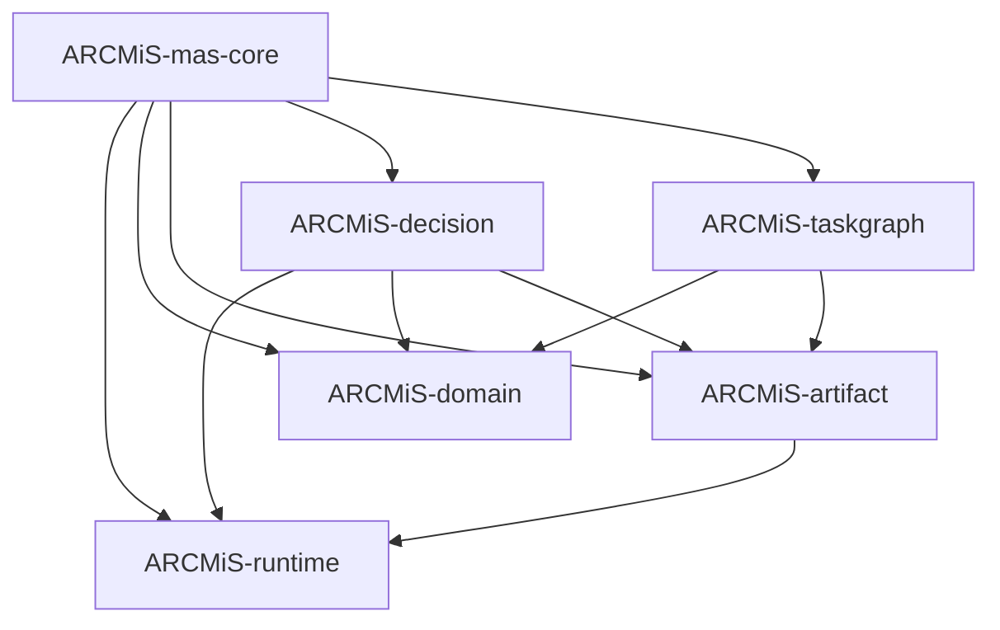

# 0041. Crate split for mas-core

- **Date:** 2026-10-12
- **Status:** accepted
- **Extends:** [0031](0031-mas-core-conductor-over-omp-transport.md), [0036](0036-hierarchical-mas-claude-code-modernization.md), [0037](0037-mas-core-refactor-implementation-plan.md)
- **Related:** [0006](0006-workspace-layout-and-cucumber-tests.md), [0009](0009-crate-naming-manifest-structure-module-layout.md), [0025](0025-middleware-hook-crate.md), [0038](0038-role-registry-claude-code-modernization.md), [0039](0039-two-level-phase-machine.md), [0040](0040-task-contract-and-artifact-store.md)

## Context

The original `ARCMiS-mas-core` crate held eighteen modules in one
binary. The modules covered distinct concerns: error classes, wire
frames, context compaction, transport, hierarchy, phase machines,
task graphs, routing, blackboard, mailbox, module phase, gateway,
artifact store, JEV decision service, verdicts, OMP advisor, and
the conductor itself. Each module had its own dependency profile
and its own test surface.

The monolith blocked three goals:

1. **Independent compilation.** Every change to any module
   recompiled the whole crate. The conductor, the gateway, and
   the frame vocabulary shared no code yet shared one build unit.
2. **Independent testing.** A failure in one module's tests blocked
   the whole crate's test run. The test surfaces did not overlap.
3. **Clear ownership.** One crate signals one maintainer concern.
   The original crate signaled eighteen concerns with no boundary.

ADR 0036 grew every one of these surfaces. ADR 0037 ordered the
growth in nine phases inside the monolith. The growth made the
monolith harder to navigate, not easier. The split had to land
before the growth, or the growth would land on top of a structure
that already resisted it.

The split followed the repo's existing crate-split precedent
(ADR 0025 extracted `ARCMiS-middleware` from the agents crate).
The split criterion was the same: a module that names no other
module in the crate is a leaf; a module that composes leaves is a
composition crate; the module that composes everything is the
conductor.

## Decision

### 1. Crate roster

Six crates replace the original monolith. Each crate owns one
clear domain boundary. The crates form a strict acyclic chain:
runtime → domain → artifact/decision/taskgraph → mas-core.

Every crate follows the naming rule from ADR 0009: package name
`ARCMiS-<name>`, `[lib] name = "<snake_case>"`, dependency alias
to the bare name. Every crate lives under `ARCMiS/lib/<name>/`.
Every crate gets its own `tests/` directory.

> **Note:** The original 19-crate split was too shallow. Crates
> were consolidated by domain into 6 deep crates: runtime,
> domain, artifact, decision, taskgraph, mas-core. Each crate
> has one clear domain boundary.

#### 1.1 `ARCMiS-runtime` — `mas_runtime` — `ARCMiS/lib/runtime/`

IO and runtime concerns: transport, frames, error, compact,
advisor.

- Public surface: `Transport` trait, `OmpTransport`,
  `OmpLaunchConfig`, `Event`, `ReadyFrame`, `ResponseFrame`,
  `PromptResultFrame`, `SubagentLifecycleFrame`,
  `SubagentProgressFrame`, `SubagentEventFrame`,
  `ExtensionUiRequestFrame`, `SessionEvent`, `PromptErrorDetail`,
  `AgentProgress`, `map_sdk_event`, `ConductorError`,
  `TransportError`, `AdvisorError`, `ValidationError`,
  `ContextFrame`, `CompactionOutcome`, `compact_frames`,
  `project_tokens`, `AdvisorConfig`, `AdvisorConsultation`,
  `AdvisorVerdict`, `OmpAdvisor`.
- Dependencies: `omp-rpc`, `serde`, `serde_json`, `thiserror`,
  `tokio`, `tracing`.
- Tests: frame deserialization, SDK event mapping, scripted
  transport, launch config, compaction arithmetic, budget
  enforcement, advisor consultation, backlog bound, defer
  behavior.

#### 1.2 `ARCMiS-domain` — `mas_domain` — `ARCMiS/lib/domain/`

Domain types and state machines: hierarchy, phase, module-phase,
gateway, blackboard, mailbox, repository, test-outcomes.

- Public surface: `Role`, `Team`, `TeamRegistry`, `Phase`,
  `Evidence`, `Transition`, `PhaseMachine`, `ModulePhase`,
  `ModuleTransition`, `ModuleStateMachine`, `ToolCall`,
  `ToolVerdict`, `Gateway`, `Revision`, `Blackboard`, `Message`,
  `Mailbox`, `Mailboxes`, `RepositoryMetadata`, `TestOutcomes`.
- Dependencies: `ARCMiS-run-config`, `serde`, `tracing`.
- Tests: role resolution, team compilation, alias table, forward
  walk, regression edges, gate evaluation, module forward walk,
  failure transitions, escalation, allow and deny patterns, deny
  dominance, revision chain, capacity bound, queue capacity,
  drain, metadata construction, outcome construction.

#### 1.3 `ARCMiS-artifact` — `mas_artifact` — `ARCMiS/lib/artifact/`

Artifact chain: artifact store and verdict computation.

- Public surface: `ArtifactId`, `ArtifactKind`, `ArtifactContent`,
  `Artifact`, `ProvenanceAction`, `ProvenanceEntry`, `Provenance`,
  `Schema`, `ValidationRule`, `ArtifactEntry`, `ArtifactStore`,
  `ValidationError`, built-in schemas, built-in validation rules,
  `Verdict`, `VerdictComputer`.
- Dependencies: `ARCMiS-runtime`, `tracing`.
- Tests: put and get, schema validation, rule validation,
  provenance chain, verdict computation from evidence.

#### 1.4 `ARCMiS-decision` — `mas_decision` — `ARCMiS/lib/decision/`

Decision making: JEV decision service and router.

- Public surface: `JevDecisionService`, `FailureTriage`,
  `NextHandler`, `EscalationPriority`, `RetryStrategy`,
  `JevConfig`, `DecisionSource`, `RouteBasis`, `RouteDecision`,
  `Router`, `RouteSignal`, `RouteContext`.
- Dependencies: `ARCMiS-runtime`, `ARCMiS-domain`,
  `ARCMiS-artifact`, `laya-rs`, `serde_json`, `tracing`.
- Tests: decision classes, confidence threshold, fallback,
  keyword routing, laya triage, cascade.

#### 1.5 `ARCMiS-taskgraph` — `mas_taskgraph` — `ARCMiS/lib/taskgraph/`

Typed task DAG with fan-out bounds, per-node repair budgets, and
stagnation detection.

- Public surface: `NodeId`, `TaskStatus`, `Kind`, `WorkItem`,
  `TaskContract`, `TaskResult`, `TaskId`, `Strategy`, `Risk`,
  `InputRef`, `WriteScope`, `FailureClass`, `GraphBudgets`,
  `StatusCounts`, `TaskGraph`.
- Dependencies: `ARCMiS-domain`, `ARCMiS-artifact`, `tracing`.
- Tests: graph construction, readiness, repair budget,
  stagnation.

#### 1.6 `ARCMiS-mas-core` — `mas_core` — `ARCMiS/lib/mas-core/`

Conductor runtime: static hierarchy, dynamic routing, tool
gateway, compaction over the omp transport.

- Public surface: `Conductor`, `RunSummary`, `RoundOutcome`,
  `RunLimits`, `ContextStore`.
- Dependencies: `ARCMiS-runtime`, `ARCMiS-domain`,
  `ARCMiS-artifact`, `ARCMiS-decision`, `ARCMiS-taskgraph`,
  `tracing`.
- Tests: full phase walk, module dispatch, two-level FSM
  coordination.

### 2. Dependency graph

The graph is acyclic. Runtime sits at the bottom. Domain sits
above runtime. Artifact, decision, and taskgraph sit above
domain. The conductor sits at the top.

```
runtime → domain → artifact/decision/taskgraph → mas-core
```



The graph has no cycles. Every edge points from a higher crate
to a lower crate. The conductor is the unique sink.

### 3. Workspace manifest

The root `Cargo.toml` already uses a glob pattern
(`members = ["ARCMiS/lib/*", "ARCMiS/bin/*"]`) that picks up every
crate under `ARCMiS/lib/`. The glob stays. The explicit list
below documents the expected members after the consolidation
lands:

```toml
[workspace]
resolver = "2"
members = [
    "ARCMiS/lib/runtime",
    "ARCMiS/lib/domain",
    "ARCMiS/lib/artifact",
    "ARCMiS/lib/decision",
    "ARCMiS/lib/taskgraph",
    "ARCMiS/lib/mas-core",
    "ARCMiS/lib/middleware",
    "ARCMiS/lib/run-config",
    "ARCMiS/bin/cli",
]
```

The glob pattern stays as the source of truth. The explicit list
above is a review aid: a reviewer can confirm every crate appears
in the list and the glob picks it up.

### 4. Migration path

The migration landed in eleven phases. Each phase ended with a
green tree (`cargo fmt --check`, `cargo clippy --workspace
--all-targets`, `cargo nextest run --workspace`). Each phase
produced one or more commits. The phases were sequential: phase
N depended on phase N-1.

#### Phases 1-7: Build the 6-crate structure

Phases 1-7 created the six new crates and migrated the modules
from the original monolith into them. Each new crate was built
and tested independently before the next phase began.

- Phase 1: `ARCMiS-runtime` (transport, frames, error, compact,
  advisor).
- Phase 2: `ARCMiS-domain` (hierarchy, phase, module-phase,
  gateway, blackboard, mailbox, repository, test-outcomes).
- Phase 3: `ARCMiS-artifact` (artifact, verdict).
- Phase 4: `ARCMiS-decision` (jev, router).
- Phase 5: `ARCMiS-taskgraph` (updated).
- Phase 6: `ARCMiS-mas-core` (updated to depend on the new
  crates).
- Phase 7: CLI integration. `ARCMiS-bin-cli` updated to depend
  on the new crates directly.

Acceptance: `cargo nextest run --workspace` passes. The six new
crates compile independently. `mas-core` re-exports the moved
types.

#### Phase 8: Delete the old crates

Delete the thirteen old crate directories under `ARCMiS/lib/`
that were superseded by the consolidation: `error`, `frames`,
`compact`, `transport`, `advisor`, `hierarchy`, `phase`,
`module-phase`, `gateway`, `blackboard`, `mailbox`, `repository`,
`test-outcomes`, `verdict`, `jev`, `router`. The workspace glob
picks up the remaining six crates automatically.

Acceptance: `cargo nextest run --workspace` passes. The
workspace contains exactly six mas-core-related crates.

#### Phase 9: Update ADR 0041

Update this ADR to reflect the 6-crate structure. Replace the
19-crate roster with the 6-crate roster. Replace the dependency
graph with the simplified chain. Add the consolidation note
explaining why the original 19-crate split was too shallow.

Acceptance: this ADR documents the final 6-crate structure.

#### Phase 10: Verify

Run the full gate suite: `cargo fmt --check`, `cargo clippy
--workspace --all-targets -- -D warnings`, `cargo nextest run
--workspace`. All gates must pass. Test count must be at least
193.

Acceptance: all gates green. Test count >= 193.

#### Phase 11: Commit

Commit the deletion and the ADR update as a single
conventional-commit change.

Acceptance: one commit lands on the working branch.

### 5. What stays out of scope

The split does not touch agent implementations. The original
`mas-core` had no agent implementations: it held only the role
enum and the team registry. Agent implementations (prompts, tool
subsets, per-role configuration) are a separate, later refactor.
When that refactor lands, it will split agents into per-team
crates. The current split leaves room for that growth: the
`ARCMiS-domain` crate owns the role enum and the team registry,
and the conductor crate owns the wiring.

The split does not touch `ARCMiS-middleware` (ADR 0025). The
middleware crate stays as it is. The split does not touch
`ARCMiS-run-config`. The run-config crate stays as it is. The
split does not touch `ARCMiS-bin-cli`. The CLI binary stays as
it is, except for the dependency update in Phase 7.

## Resolved questions

Five open questions surfaced during the split design. Each
question is recorded with its resolution. The resolutions are
final and bind the migration phases.

**Q1: Does the JEV decision service need the runtime error
types?**

Resolution: yes. JEV decision failures (confidence below
threshold, model load error, inference timeout) are failure
classes that belong in the runtime crate. The `ARCMiS-decision`
crate depends on `ARCMiS-runtime` for error types.

**Q2: Does the router need the taskgraph and artifact crates?**

Resolution: yes. The router inspects `WorkItem` (from
taskgraph) to determine routing context, and references
`Artifact` (from artifact) for input provenance. The
`ARCMiS-decision` crate depends on both `ARCMiS-taskgraph` and
`ARCMiS-artifact`.

**Q3: Does the advisor need the frame types?**

Resolution: yes. The advisor consumes `Event` frames from the
transport and produces `AdvisorVerdict` responses. The
`ARCMiS-runtime` crate owns both the transport and the frame
types, so the advisor lives in the same crate.

**Q4: Where do `context.rs` and `frame_sink.rs` live?**

Resolution: inside `ARCMiS-mas-core` as conductor internals.
They are tightly coupled to the conductor's event loop and have
no value as standalone crates.

**Q5: Where does `conductor.rs` live?**

Resolution: inside `ARCMiS-mas-core`. The conductor is the
crate's raison d'être; it wires all composition crates
together.

## Consequences

- Six crates replace the original monolith. The workspace grows
  from three crates to nine crates (six new plus the existing
  `ARCMiS-middleware`, `ARCMiS-run-config`, and `ARCMiS-bin-cli`).
- Compilation parallelism improves. Independent crates compile
  in parallel. A change to the gateway no longer recompiles the
  frame vocabulary.
- Test isolation improves. Each crate's tests run independently.
  A failure in one crate's tests does not block another crate's
  tests.
- Ownership boundaries clarify. Each crate has one maintainer
  concern. The conductor crate owns the run lifetime. The
  composition crates own their domains. The leaf crates own
  their primitives.
- The conductor crate becomes thin. It holds only the wiring.
  The domain logic lives in the composition crates.
- The dependency graph is acyclic. Every edge points from a
  higher crate to a lower crate. The conductor is the unique
  sink.
- Agent implementations remain in `mas-core` for now. The
  original `mas-core` had no agent implementations, so the split
  does not move any agent code. A later refactor will split
  agents into per-team crates.
- The migration lands in eleven phases. Each phase ends with a
  green tree. Each phase produces one or more commits. The
  phases are sequential.
- The workspace manifest uses a glob pattern. The glob picks up
  every crate under `ARCMiS/lib/`. The explicit list in section
  3 is a review aid, not a source of truth.

## Verification

- **Unit:** each crate's `tests/` directory passes independently.
  `cargo nextest run -p ARCMiS-<name>` passes for every crate.
- **Integration:** `mas-core` integration tests pass with all
  composition crates. `cargo nextest run -p ARCMiS-mas-core`
  passes.
- **E2E:** the CLI runs the full phase walk with the example
  config. `mise run cli -- configs/example.yml` reaches `Done`
  with `Proven` verdicts on every module.
- **Workspace:** `cargo build --workspace` succeeds.
- **Workspace:** `cargo nextest run --workspace` succeeds.
- **Acyclicity:** `cargo metadata --format-version 1 | jq
  '.resolve.nodes[].dependencies[].name' | sort -u` shows no
  cycle. Every workspace crate appears exactly once in the
  dependency list of every other workspace crate that depends
  on it.
- **Backward compatibility:** the existing `c15-gr-hierarchy-smoke`
  run reproduces byte-identically when the hierarchy is
  disabled. The refactored conductor does not change the
  single-tier behavior.
