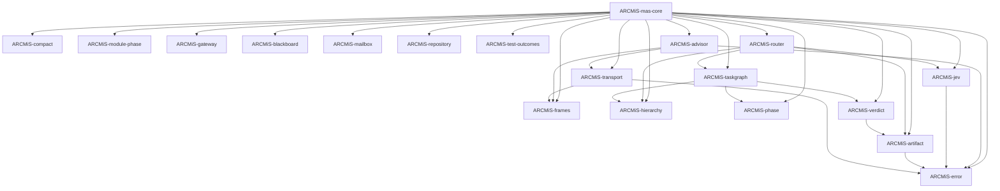

# 0041. Crate split for mas-core

- **Date:** 2026-10-12
- **Status:** accepted
- **Extends:** [0031](0031-mas-core-conductor-over-omp-transport.md), [0036](0036-hierarchical-mas-claude-code-modernization.md), [0037](0037-mas-core-refactor-implementation-plan.md)
- **Related:** [0006](0006-workspace-layout-and-cucumber-tests.md), [0009](0009-crate-naming-manifest-structure-module-layout.md), [0025](0025-middleware-hook-crate.md), [0038](0038-role-registry-claude-code-modernization.md), [0039](0039-two-level-phase-machine.md), [0040](0040-task-contract-and-artifact-store.md)

## Context

The current `ARCMiS-mas-core` crate holds eighteen modules in one
binary. The modules cover distinct concerns: error classes, wire
frames, context compaction, transport, hierarchy, phase machines,
task graphs, routing, blackboard, mailbox, module phase, gateway,
artifact store, JEV decision service, verdicts, OMP advisor, and
the conductor itself. Each module has its own dependency profile
and its own test surface.

The monolith blocks three goals:

1. **Independent compilation.** Every change to any module
   recompiles the whole crate. The conductor, the gateway, and the
   frame vocabulary share no code yet share one build unit.
2. **Independent testing.** A failure in one module's tests blocks
   the whole crate's test run. The test surfaces do not overlap.
3. **Clear ownership.** One crate signals one maintainer concern.
   The current crate signals eighteen concerns with no boundary.

ADR 0036 grows every one of these surfaces. ADR 0037 orders the
growth in nine phases inside the monolith. The growth makes the
monolith harder to navigate, not easier. The split must land
before the growth, or the growth lands on top of a structure that
already resists it.

The split follows the repo's existing crate-split precedent
(ADR 0025 extracted `ARCMiS-middleware` from the agents crate).
The split criterion is the same: a module that names no other
module in the crate is a leaf; a module that composes leaves is a
composition crate; the module that composes everything is the
conductor.

## Decision

### 1. Crate roster

Nineteen crates replace the current monolith. Four are leaves
with no workspace dependencies. Fourteen are composition crates
that depend on leaves and on each other in a strict acyclic
order. One is the conductor that wires the composition crates
together.

Every crate follows the naming rule from ADR 0009: package name
`ARCMiS-<name>`, `[lib] name = "<snake_case>"`, dependency alias
to the bare name. Every crate lives under `ARCMiS/lib/<name>/`.
Every crate gets its own `tests/` directory.

#### 1.1 Leaf crates

Leaf crates have no workspace dependencies. They depend only on
external crates from `[workspace.dependencies]`.

**1. `ARCMiS-error` — `mas_error` — `ARCMiS/lib/error/`**

- Public surface: `ConductorError`, `TransportError`,
  `AdvisorError`, `ValidationError`.
- Dependencies: `thiserror`.
- Tests: error construction, `Display` impls, `From` conversions.

**2. `ARCMiS-frames` — `mas_frames` — `ARCMiS/lib/frames/`**

- Public surface: `Event`, `ReadyFrame`, `ResponseFrame`,
  `PromptResultFrame`, `SubagentLifecycleFrame`,
  `SubagentProgressFrame`, `SubagentEventFrame`,
  `ExtensionUiRequestFrame`, `SessionEvent`, `PromptErrorDetail`,
  `AgentProgress`, `map_sdk_event`.
- Dependencies: `serde`, `serde_json`, `omp-rpc`.
- Tests: frame deserialization, SDK event mapping.

**3. `ARCMiS-compact` — `mas_compact` — `ARCMiS/lib/compact/`**

- Public surface: `ContextFrame`, `CompactionOutcome`,
  `compact_frames`, `project_tokens`.
- Dependencies: `tracing`.
- Tests: compaction arithmetic, budget enforcement.

**4. `ARCMiS-transport` — `mas_transport` — `ARCMiS/lib/transport/`**

- Public surface: `Transport` trait, `OmpTransport`,
  `OmpLaunchConfig`, `TransportError`.
- Dependencies: `ARCMiS-frames`, `ARCMiS-error`, `omp-rpc`,
  `tokio`, `tracing`.
- Tests: scripted transport, launch config.

#### 1.2 Composition crates

Composition crates depend on leaves and on each other in a strict
acyclic order. The order is: pure-std crates first, then
artifact, then verdict, then taskgraph, then router, then advisor.

**5. `ARCMiS-hierarchy` — `mas_hierarchy` — `ARCMiS/lib/hierarchy/`**

- Public surface: `Role`, `Team`, `TeamRegistry`.
- Dependencies: `ARCMiS-run-config`.
- Tests: role resolution, team compilation, alias table.

**6. `ARCMiS-phase` — `mas_phase` — `ARCMiS/lib/phase/`**

- Public surface: `Phase`, `Evidence`, `Transition`,
  `PhaseMachine`.
- Dependencies: none beyond `std`.
- Tests: forward walk, regression edges, gate evaluation.

**7. `ARCMiS-module-phase` — `mas_module_phase` —
`ARCMiS/lib/module-phase/`**

- Public surface: `ModulePhase`, `ModuleTransition`,
  `ModuleStateMachine`.
- Dependencies: none beyond `std`.
- Tests: module forward walk, failure transitions, escalation.

**8. `ARCMiS-gateway` — `mas_gateway` — `ARCMiS/lib/gateway/`**

- Public surface: `ToolCall`, `ToolVerdict`, `Gateway`.
- Dependencies: none beyond `std`.
- Tests: allow and deny patterns, deny dominance.

**9. `ARCMiS-blackboard` — `mas_blackboard` —
`ARCMiS/lib/blackboard/`**

- Public surface: `Revision`, `Blackboard`.
- Dependencies: none beyond `std`.
- Tests: revision chain, capacity bound.

**10. `ARCMiS-mailbox` — `mas_mailbox` — `ARCMiS/lib/mailbox/`**

- Public surface: `Message`, `Mailbox`, `Mailboxes`.
- Dependencies: none beyond `std`.
- Tests: queue capacity, drain.

**11. `ARCMiS-repository` — `mas_repository` —
`ARCMiS/lib/repository/`**

- Public surface: `RepositoryMetadata`.
- Dependencies: none beyond `std`.
- Tests: metadata construction.

**12. `ARCMiS-test-outcomes` — `mas_test_outcomes` —
`ARCMiS/lib/test-outcomes/`**

- Public surface: `TestOutcomes`.
- Dependencies: none beyond `std`.
- Tests: outcome construction.

**13. `ARCMiS-artifact` — `mas_artifact` — `ARCMiS/lib/artifact/`**

- Public surface: `ArtifactId`, `ArtifactKind`, `ArtifactContent`,
  `Artifact`, `ProvenanceAction`, `ProvenanceEntry`, `Provenance`,
  `Schema`, `ValidationRule`, `ArtifactEntry`, `ArtifactStore`,
  `ValidationError`, built-in schemas, built-in validation rules.
- Dependencies: `ARCMiS-error`.
- Tests: put and get, schema validation, rule validation,
  provenance chain.

**14. `ARCMiS-jev` — `mas_jev` — `ARCMiS/lib/jev/`**

- Public surface: `JevDecisionService`, `FailureTriage`,
  `NextHandler`, `EscalationPriority`, `RetryStrategy`,
  `JevConfig`.
- Dependencies: `ARCMiS-error`, `laya-rs`.
- Tests: decision classes, confidence threshold, fallback.

**15. `ARCMiS-verdict` — `mas_verdict` — `ARCMiS/lib/verdict/`**

- Public surface: `Verdict`, `VerdictComputer`.
- Dependencies: `ARCMiS-artifact`.
- Tests: verdict computation from evidence.

**16. `ARCMiS-taskgraph` — `mas_taskgraph` —
`ARCMiS/lib/taskgraph/`**

- Public surface: `NodeId`, `TaskStatus`, `Kind`, `WorkItem`,
  `TaskContract`, `TaskResult`, `TaskId`, `Strategy`, `Risk`,
  `InputRef`, `WriteScope`, `FailureClass`, `GraphBudgets`,
  `StatusCounts`, `TaskGraph`.
- Dependencies: `ARCMiS-hierarchy`, `ARCMiS-phase`,
  `ARCMiS-verdict`.
- Tests: graph construction, readiness, repair budget,
  stagnation.

**17. `ARCMiS-router` — `mas_router` — `ARCMiS/lib/router/`**

- Public surface: `DecisionSource`, `RouteBasis`, `RouteDecision`,
  `Router`, `RouteSignal`, `RouteContext`.
- Dependencies: `ARCMiS-hierarchy`, `ARCMiS-jev`, `ARCMiS-taskgraph`,
  `ARCMiS-artifact`.
- Tests: keyword routing, laya triage, cascade.

**18. `ARCMiS-advisor` — `mas_advisor` — `ARCMiS/lib/advisor/`**

- Public surface: `AdvisorConfig`, `AdvisorConsultation`,
  `AdvisorVerdict`, `AdvisorError`, `OmpAdvisor`.
- Dependencies: `ARCMiS-transport`, `ARCMiS-error`, `ARCMiS-frames`.
- Tests: consultation, backlog bound, defer behavior.

#### 1.3 Conductor crate

The conductor wires the composition crates together. It owns the
run lifetime, the transport handle, the task graph, the phase
machines, the artifact store, the router, the gateway, the
blackboard, the mailbox, the advisor, and the JEV service.

**19. `ARCMiS-mas-core` — `mas_core` — `ARCMiS/lib/mas-core/`**

- Public surface: `Conductor`, `RunSummary`, `RoundOutcome`,
  `RunLimits`, `ContextStore`.
- Dependencies: every composition crate and every leaf crate.
- Tests: full phase walk, module dispatch, two-level FSM
  coordination.

### 2. Dependency graph

The graph is acyclic. Leaves sit at the bottom. Pure-std
composition crates sit above the leaves. Artifact, verdict, and
taskgraph form a chain above the pure-std crates. Router and
advisor sit above artifact and verdict. The conductor sits at the
top.



The graph has no cycles. Every edge points from a higher crate
to a lower crate. The conductor is the unique sink.

### 3. Workspace manifest

The root `Cargo.toml` already uses a glob pattern
(`members = ["ARCMiS/lib/*", "ARCMiS/bin/*"]`) that picks up every
new crate under `ARCMiS/lib/`. The glob stays. The explicit list
below documents the expected members after the split lands:

```toml
[workspace]
resolver = "2"
members = [
    "ARCMiS/lib/error",
    "ARCMiS/lib/frames",
    "ARCMiS/lib/compact",
    "ARCMiS/lib/transport",
    "ARCMiS/lib/hierarchy",
    "ARCMiS/lib/phase",
    "ARCMiS/lib/module-phase",
    "ARCMiS/lib/gateway",
    "ARCMiS/lib/blackboard",
    "ARCMiS/lib/mailbox",
    "ARCMiS/lib/repository",
    "ARCMiS/lib/test-outcomes",
    "ARCMiS/lib/artifact",
    "ARCMiS/lib/jev",
    "ARCMiS/lib/verdict",
    "ARCMiS/lib/taskgraph",
    "ARCMiS/lib/router",
    "ARCMiS/lib/advisor",
    "ARCMiS/lib/mas-core",
    "ARCMiS/lib/middleware",
    "ARCMiS/lib/run-config",
    "ARCMiS/bin/cli",
]
```

The glob pattern stays as the source of truth. The explicit list
above is a review aid: a reviewer can confirm every new crate
appears in the list and the glob picks it up.

### 4. Migration path

The migration lands in six phases. Each phase ends with a green
tree (`cargo fmt --check`, `cargo clippy --workspace
--all-targets`, `cargo nextest run --profile ci --workspace
--all-targets --no-tests=pass`). Each phase produces one or more
commits. The phases are sequential: phase N depends on phase N-1.

#### Phase A: Leaf crates

Create the four leaf crates. Move the corresponding modules from
`mas-core` into each crate. Add the new crates to the workspace
manifest. Update `mas-core` to re-export from the new crates so
existing call sites keep working.

- `ARCMiS-error` from `mas-core/src/error.rs`.
- `ARCMiS-frames` from `mas-core/src/frames.rs`.
- `ARCMiS-compact` from `mas-core/src/compact.rs`.
- `ARCMiS-transport` from `mas-core/src/transport.rs`.

Acceptance: `cargo nextest run --profile ci --workspace
--all-targets --no-tests=pass` passes. The four new crates
compile independently. `mas-core` re-exports the moved types.

#### Phase B: Pure-std composition crates

Create the eight composition crates that depend only on `std` and
on `ARCMiS-run-config`. Move the corresponding modules from
`mas-core` into each crate. Update `mas-core` to re-export.

- `ARCMiS-hierarchy` from `mas-core/src/hierarchy.rs`.
- `ARCMiS-phase` from `mas-core/src/phase.rs`.
- `ARCMiS-module-phase` from `mas-core/src/module_phase.rs`.
- `ARCMiS-gateway` from `mas-core/src/gateway.rs`.
- `ARCMiS-blackboard` from `mas-core/src/blackboard.rs`.
- `ARCMiS-mailbox` from `mas-core/src/mailbox.rs`.
- `ARCMiS-repository` (new file, content from ADR 0037 phase 4).
- `ARCMiS-test-outcomes` (new file, content from ADR 0037 phase
  4).

Acceptance: `cargo nextest run --profile ci --workspace
--all-targets --no-tests=pass` passes. The eight new crates
compile independently.

#### Phase C: Artifact chain

Create the six composition crates that depend on leaves and on
each other. Move the corresponding modules from `mas-core` into
each crate. Update `mas-core` to re-export.

- `ARCMiS-artifact` from `mas-core/src/artifact.rs`.
- `ARCMiS-jev` from `mas-core/src/jev.rs`.
- `ARCMiS-verdict` from `mas-core/src/verdict.rs` (new file,
  content from ADR 0037 phase 5).
- `ARCMiS-taskgraph` from `mas-core/src/taskgraph.rs`.
- `ARCMiS-router` from `mas-core/src/router.rs`.
- `ARCMiS-advisor` from `mas-core/src/advisor.rs`.

Acceptance: `cargo nextest run --profile ci --workspace
--all-targets --no-tests=pass` passes. The six new crates
compile independently. The dependency graph stays acyclic.

#### Phase D: Slim mas-core

Remove the moved modules from `mas-core`. Replace the re-exports
with direct imports from the new crates. The conductor crate
becomes thin: it holds only `conductor.rs`, `context.rs`,
`frame_sink.rs`, and `lib.rs`.

Acceptance: `cargo nextest run --profile ci --workspace
--all-targets --no-tests=pass` passes. `mas-core` depends on
every composition crate and every leaf crate. The conductor
crate compiles in under five seconds on a clean build.

#### Phase E: CLI integration

Update `ARCMiS-bin-cli` to depend on the new crates directly
instead of through `mas-core` re-exports. The CLI gains direct
access to `ARCMiS-hierarchy`, `ARCMiS-phase`, `ARCMiS-taskgraph`,
and the other composition crates.

Acceptance: `cargo nextest run --profile ci --workspace
--all-targets --no-tests=pass` passes. `mise run cli --
configs/example.yml` runs the full phase walk and reaches `Done`.

#### Phase F: Remove old modules

Delete the old module files from `mas-core`. Delete the
re-export shims. The conductor crate holds only the conductor,
the context store, and the frame sink.

Acceptance: `cargo nextest run --profile ci --workspace
--all-targets --no-tests=pass` passes. `mas-core` has no
re-exports. Every type lives in its own crate.

### 5. What stays out of scope

The split does not touch agent implementations. The current
`mas-core` has no agent implementations: it holds only the role
enum and the team registry. Agent implementations (prompts, tool
subsets, per-role configuration) are a separate, later refactor.
When that refactor lands, it will split agents into per-team
crates. The current split leaves room for that growth: the
`ARCMiS-hierarchy` crate owns the role enum and the team
registry, and the conductor crate owns the wiring.

The split does not touch `ARCMiS-middleware` (ADR 0025). The
middleware crate stays as it is. The split does not touch
`ARCMiS-run-config`. The run-config crate stays as it is. The
split does not touch `ARCMiS-bin-cli`. The CLI binary stays as
it is, except for the dependency update in Phase E.

## Resolved questions

Five open questions surfaced during the split design. Each
question is recorded with its resolution. The resolutions are
final and bind the migration phases.

**Q1: Does `ARCMiS-jev` need `ARCMiS-error`?**

Resolution: yes. JEV decision failures (confidence below
threshold, model load error, inference timeout) are failure
classes that belong in the error crate. Add `ARCMiS-error` to
`ARCMiS-jev` dependencies.

**Q2: Does `ARCMiS-router` need `ARCMiS-taskgraph` and
`ARCMiS-artifact`?**

Resolution: yes. The router inspects `WorkItem` (from taskgraph)
to determine routing context, and references `Artifact` (from
artifact) for input provenance. Add both `ARCMiS-taskgraph` and
`ARCMiS-artifact` to `ARCMiS-router` dependencies.

**Q3: Does `ARCMiS-advisor` need `ARCMiS-frames`?**

Resolution: yes. The advisor consumes `Event` frames from the
transport and produces `AdvisorVerdict` responses. Add
`ARCMiS-frames` to `ARCMiS-advisor` dependencies.

**Q4: Where do `context.rs` and `frame_sink.rs` live?**

Resolution: inside `ARCMiS-mas-core` as conductor internals.
They are tightly coupled to the conductor's event loop and have
no value as standalone crates.

**Q5: Where does `conductor.rs` live?**

Resolution: inside `ARCMiS-mas-core`. The conductor is the
crate's raison d'être; it wires all composition crates
together.

## Consequences

- Nineteen crates replace one monolith. The workspace grows from
  three crates to twenty-one crates (nineteen new plus the
  existing `ARCMiS-middleware`, `ARCMiS-run-config`, and
  `ARCMiS-bin-cli`).
- Compilation parallelism improves. Independent crates compile
  in parallel. A change to the gateway no longer recompiles the
  frame vocabulary.
- Test isolation improves. Each crate's tests run independently.
  A failure in one crate's tests does not block another crate's
  tests.
- Ownership boundaries clarify. Each crate has one maintainer
  concern. The conductor crate owns the run lifetime. The
  composition crates own their domains. The leaf crates own
  their primitives.
- The conductor crate becomes thin. It holds only the wiring.
  The domain logic lives in the composition crates.
- The dependency graph is acyclic. Every edge points from a
  higher crate to a lower crate. The conductor is the unique
  sink.
- Agent implementations remain in `mas-core` for now. The
  current `mas-core` has no agent implementations, so the split
  does not move any agent code. A later refactor will split
  agents into per-team crates.
- The migration lands in six phases. Each phase ends with a
  green tree. Each phase produces one or more commits. The
  phases are sequential.
- The workspace manifest uses a glob pattern. The glob picks up
  every new crate under `ARCMiS/lib/`. The explicit list in
  section 3 is a review aid, not a source of truth.

## Verification

- **Unit:** each crate's `tests/` directory passes independently.
  `cargo nextest run --profile ci -p ARCMiS-<name>
  --no-tests=pass` passes for every new crate.
- **Integration:** `mas-core` integration tests pass with all
  composition crates. `cargo nextest run --profile ci -p
  ARCMiS-mas-core --no-tests=pass` passes.
- **E2E:** the CLI runs the full phase walk with the example
  config. `mise run cli -- configs/example.yml` reaches `Done`
  with `Proven` verdicts on every module.
- **Workspace:** `cargo build --workspace` succeeds.
- **Workspace:** `cargo nextest run --profile ci --workspace
  --all-targets --no-tests=pass` succeeds.
- **Acyclicity:** `cargo metadata --format-version 1 | jq
  '.resolve.nodes[].dependencies[].name' | sort -u` shows no
  cycle. Every workspace crate appears exactly once in the
  dependency list of every other workspace crate that depends
  on it.
- **Backward compatibility:** the existing `c15-gr-hierarchy-smoke`
  run reproduces byte-identically when the hierarchy is
  disabled. The refactored conductor does not change the
  single-tier behavior.
