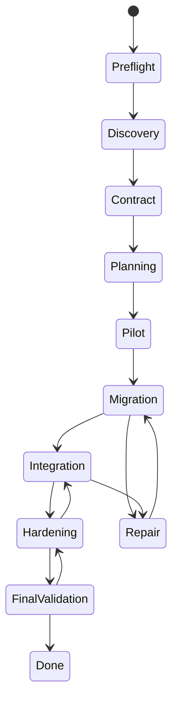

# Product Specification

- **Date:** 2026-10-11
- **Status:** accepted

## What the product is

ARCMiS is an autonomous multi-agent system (MAS) for repository-level
software modernization: it translates a legacy codebase into a target
language and proves the result with tests. The problem statement is the
ReCodeAgent problem ([arXiv:2604.07341](http://arxiv.org/abs/2604.07341)):
language-agnostic translation and validation of large-scale repositories
through static analysis plus LLM agents. ARCMiS attacks the same problem
with a different posture: small language models (SLM) orchestrated on a
three-tier hierarchy, not one frontier model.

## Users

- **Modernization engineers.** They want a translated, test-passing
  codebase plus a traceable run record.
- **Researchers.** They want a reproducible agent harness against the
  ReCodeAgent tool-project datasets.
- **Operators.** They own the machine and the model posture. They want
  cost-visible runs with bounded budgets.

## Inputs

1. **Input codebase directory.** The repository to modernize. Read-only
   territory for the run.
2. **Run configuration file.** One mandatory YAML file per run. The
   CLI requires an explicit path to it, with no default (ADR 0032). The
   schema and its validated example live in `configs/example.yml` and in
   the crate `ARCMiS/lib/run-config`.

The run configuration names: the run, input and output paths, the
source-target language pair, the target test command, the model
identifier, the hierarchy layout, blackboard bounds, the guard policy,
compaction thresholds, the laya settings, and the budget limits.

## Outputs

- **Modernized codebase** under `paths.output_dir`.
- **Planning artifacts**: source maps, migration plan, phase evidence,
  written by agents under `paths.output_dir`.
- **Structured run result**: traces, per-phase decision ledgers, and a
  final run report.

## Agent organization

A **static three-tier hierarchy** (ADR 0026) with **dynamic adaptive
routing** at runtime (ADR 0022):

- **Tier 1: orchestrator plus advisory fleet-analyst.** The
  orchestrator owns the phase machine, the delegations, and the
  escalation policy. The fleet-analyst advises on model-promotion
  questions. Tier 1 stays cheap. Its history carries macro work only.
- **Tier 2: leads.**
  - `discovery-lead` over `{analyst, architect}`
  - `migration-lead` over `{translator, validator, tester, repairer}`
  - `integration-lead` over `{planner, failure-analyst, critic}`
- **Tier 3: specialists.** Frozen role registry, one preamble and one
  tool allowlist each.

Selection and composition are dynamic: the router inspects intermediate
state and picks the next actor. The routing cascade is deterministic
first, laya typed decisions at the bottlenecks, and model arbitration
only for the ambiguous remainder (ADRs 0022, 0027, 0031).

## Phase machine

Forward movement needs evidence-gated phase exit: a phase ends only
when its gate criteria hold. Failures regress backwards to the phase
that can repair them, with bounded retries.

## Communication

- **Shared blackboard.** Topics are the single rendezvous point for
  findings, plans, and artifacts. Writers append topic revisions.
- **Direct agent messaging.** Leads message members under their team.
  Every message rides the blackboard transport with per-mailbox bounds.

## Model posture

SLM-first: the default candidate is `ashaiballant/qwen3.8-27b-df2`,
run under omp-RPC (ADR 0030). Frontier models remain configurable
through the model identifier in the run configuration. Cost visibility
comes from bounded budgets: turns, fanout, collective turns, and
stagnation rounds.

## Benchmark readiness

The system targets the ReCodeAgent tool-project datasets (crust,
oxidizer, alphatrans, skel) as its evaluation benchmark set. Those runs
have not begun yet. Any benchmark claim before those runs begin is
marked as an expectation, not a result.

## References

- ReCodeAgent artifact: `assets/ReCodeAgent/` (datasets, Docker, prompts).
- Technical foundation: [TECH-SPECS.md](TECH-SPECS.md).
- Decision records: `docs/adr/` 0022, 0026, 0027, 0030, 0031, 0032.
